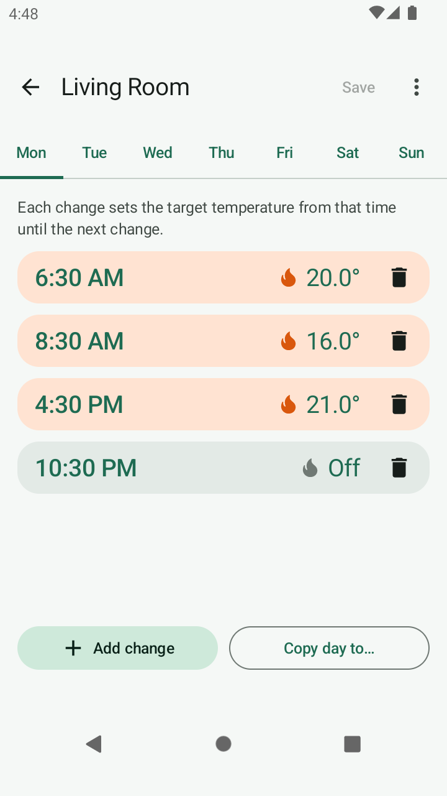

# Wiser Local

A small, unofficial Android app for Drayton Wiser heating hubs. It talks straight
to the hub over your home network using the hub's local REST API, with no cloud
account involved*.

<p>
  
  
  
  
  
</p>

<sub>Screenshots show example data, not a real home.</sub>

## Why this app?

Wiser makes some great products and hardware, but the official app is missing Android features. It's laggy and uses a webview for insights as it's made with .net. This app is native kotlin so it's fast and adds Android features like app icon shortcuts, quick tile shortcuts, home screen and lock screen widgets. Most importantly it's open source and tracks or logs zero activity.

It only works while the phone can reach the hub, so on your home Wi-Fi or over a
VPN into your home network*.

Not affiliated with or endorsed by Drayton or Schneider Electric. The local API
is undocumented and could change with a firmware update.

## What it does

Four tabs, plus a settings page behind the gear icon.

### Home

- Whether the boiler or heat source is being called for heat
- Away mode, boost all rooms and cancel overrides
- Your favourite rooms and hot water with their controls (choose and order them with **Edit**)
- Your Moments, one tap to run
- Live updates on hubs that support them: changes made elsewhere (the official
  app, a thermostat) show within a second or two, and the status line says "live"

### Automations

**Moments:** create, edit, rename, delete and run. Each action can:

- set a room's temperature, boost it for a time or send it back to its schedule
- turn the hot water on, off, on for a time or back to its schedule
- on hubs with them: switch or dim a light, switch a smart plug, lift or tilt a
  shutter, set a cooling room's mode or turn it on or off, set a room's heating
  level in percent, start, pause or switch an EV charger, set a fan's speed or a
  PowerTag C output

Waits and notifications added in the official app are kept.

**Schedules:**

- A weekly editor for each heating schedule and for hot water
- Copy and paste as text, like `Monday: 06:00 19.0, 08:00 17.5, 22:00 Off`
- Add, rename, copy and delete heating schedules

**Automations:**

- Create and edit them, switch them on or off, and delete them
- Conditions: away mode, hot water, and times including sunrise and sunset
- Actions: notifications, waits, Moments, rooms and hot water

Moments and automations show their icon, and you can choose it when editing.

### Control

Every room and the hot water, with:

- Target temperature, boost, and hold a temperature for a set time
- Mode (schedule, manual, off) and advance to the next scheduled setting
- The next scheduled change, humidity and window state
- One tab per room, which also lists its devices

### Insights

From your Wiser account:

- Energy saved this month and the monthly trend
- Hours saved by away and eco mode, and activity counts
- Heating hours over the last 30 days against the outdoor minimum and maximum
- The heat report: room temperatures, set points and outdoor temperature by
  day, week or month, drawn in the app. Tap or drag on the chart for the values
  at a time, and tap a name to hide it.

### Settings

- **Hub connection:** scan the QR code on the hub to get its secret, and
  automatic hub discovery
- **Rooms:** each with its device count. A room's page renames it, chooses or
  edits its schedule, switches open window detection, sets its heating type,
  occupancy settings and heating channel (on hubs with more than one), lists its
  devices and deletes it.
- **Devices:** a page each with its name, battery, signal and readings, room,
  button lock, radiator valve battery type, firmware, identify and delete. Add a
  new device, with an install code if it has one, scanned from its QR code as
  the official app does for newer radiator valves and other devices.
- **Away mode:** away temperature, and whether hot water turns off too
- **Smart modes:** eco and comfort
- **System:**
  - hub firmware, automatic firmware updates, restarting the hub, cloud and
    Wi-Fi details, hub clock
  - heat source and boiler type, hot water channel, brand, valve protection
  - OpenTherm: hot water and heating water temperatures, boiler readings, and
    burner and pump statistics
  - legacy PowerTag energy mode and Zigbee network details
- Home screen favourites, and light or dark theme

### Equipment

Only on hubs that have any. Covers lights, shutters, smart plugs, smoke alarms,
EV chargers, PowerTag energy meters and outputs, appliances, underfloor heating,
heating actuators, fans, motion, door, window and light sensors, heat pumps and
thermostat displays.

- Each gets a page with its readings and the official app's controls and
  settings, for example:
  - a light's brightness, mode, away action, power-on behaviour and dimming range
  - a shutter's position, tilt, motor timings and slat angles
  - a heating actuator's output, cycle time and floor sensor limits
  - a PowerTag's installation type and grid limit
  - high- and low-power alarms on appliances
- Its name and room, and a schedule for lights, shutters, fans, plugs and
  chargers. Light, shutter and fan schedules ("Level" schedules, in percent) can
  be edited.
- What each button on a button panel does (any action a Moment can do)
- Zigbee groups of lights and shutters: create, add or remove devices, rename,
  delete
- Where the hub supports them, System settings adds summer comfort, seasonal
  comfort, cooling and underfloor settings, the dynamic energy tariff (price
  now, today's average, cheapest and dearest times) and Matter pairing. Room
  pages add summer comfort, cooling, heat pump mode and floor sensor settings.

All of this follows the official app's requests but has only been tested
against a simulated hub.

### Outside the app

- **Home screen widget:** current and target temperature for one room
- **Quick settings tiles:** hot water boost, and away mode
- **App icon shortcuts:** long-press the app icon for away mode on/off, hot water
  boost, boost all rooms and your Moments. They run without opening the app and
  confirm with a short message, and each can be dragged onto the home screen.
  Only what your hub supports is offered, and launchers show the first four or
  five.

## Setup

1. Give the hub a fixed IP address (a DHCP reservation on your router).
2. Get the hub's secret. The easy way: in the app's **Hub connection** page,
   press **Setup** on the hub so its light flashes, tap **Scan the QR code on
   the hub** and scan the code on the hub's label. The phone joins the hub's
   own Wi-Fi for a moment (Android asks you to allow it), reads the secret and
   goes back to your Wi-Fi. Press **Setup** again afterwards. The scanner is
   Google's code scanner, so it needs Google Play services but no camera
   permission. By hand instead:
   - Press the **Setup** button on the hub so its light flashes.
   - Join the hub's Wi-Fi network (named on its label, `Wiser_XXXXXX` or
     `WiserHeatXXXXXX`) from your phone.
   - Open `http://192.168.8.1/secret/` in a browser and copy the text.
   - Press **Setup** again to return the hub to normal.
3. Enter the hub's IP address (or tap **Find hub on this network**) and the
   secret, and tap **Save and test connection**.
4. Optional: add the **Room temperature** widget from your launcher's widget
   picker, and add the **Water boost** tile by editing your quick settings.

The boost length (default 60 minutes) and the room shown on the widget are in
the app's Settings.

## Building

Open the folder in Android Studio, or from a terminal with JDK 17 or newer:

```bash
./gradlew assembleDebug
```

The APK is written to `app/build/outputs/apk/debug/app-debug.apk`.

How releases are built and signed is in [RELEASING.md](RELEASING.md).

## Installing and updating

Download the APK from the [Releases](https://github.com/pgfsim/wiser-local-android/releases)
page and open it on your phone. Android asks you to allow installs from your
browser or file manager the first time.

Every release is signed with the same key. To check an APK came from this
project, compare its signing certificate
(`apksigner verify --print-certs wiser-local-vX.Y.Z.apk`) with this SHA-256
fingerprint:

```
46:AB:15:6F:CF:A0:0C:D0:CA:FB:35:D7:0E:0D:A8:6E:69:2A:72:51:D0:6F:4A:50:8F:8F:01:E9:43:30:FE:6E
```

`apksigner` prints the same value in lower case without colons:
`46ab156fcfa00cd0cafb35d70e0da86e692a7251d06f4a508f8f01e94330fe6e`. Each
release also has a `.sha256` file with the APK's checksum.

The app looks for a newer release once a day, and whenever **Settings → Check
for updates** is tapped. If there is one it offers **Update** or **Later**;
updating is never required. Before installing, it checks the download against
the release's checksum and that it is signed with the same key as the installed
copy. Android then asks you to confirm, and the first time, to allow installs
from Wiser Local.

A copy you built yourself (or any debug build) is signed with a different key,
so it can't update to a release: uninstall it and install the release once.

## How it works

Everything hub-related is in [`WiserHub.kt`](app/src/main/java/dev/wiserlocal/app/WiserHub.kt).
Requests go to `http://<hub>/data/v2/domain/` (falling back to `/data/domain/`
on older firmware) with the secret in a `SECRET` header. Newer firmware redirects
to HTTPS with a self-signed certificate; the app then switches to HTTPS for that
hub and accepts its certificate without verifying it. Temperatures are sent
in tenths of a degree.

| Action | Request |
| --- | --- |
| Read everything | `GET /data/v2/domain/` |
| Set room target | `PATCH Room/{id}` `{"RequestOverride":{"Type":"Manual","SetPoint":205}}` |
| Resume schedule | `PATCH Room/{id}` `{"RequestOverride":{"Type":"None"}}` |
| Boost hot water | `PATCH HotWater/{id}` `{"RequestOverride":{"Type":"Manual","DurationMinutes":60,"SetPoint":1100}}` |
| Cancel boost | `PATCH HotWater/{id}` `{"RequestOverride":{"Type":"None"}}` |
| Boost room | `PATCH Room/{id}/RequestOverride/` `{"Type":"Boost","DurationMinutes":60}` (the hub picks the increase) |
| Room mode | `PATCH Room/{id}` `{"Mode":"Auto"}` or `{"Mode":"Manual"}` |
| Window detection | `PATCH Room/{id}` `{"WindowDetectionActive":true}` |
| Hot water mode | `PATCH HotWater/{id}` `{"Mode":"Manual","RequestOverride":{"Type":"None"}}` |
| Away mode | `PATCH System/RequestOverride` `{"Type":"Away"}` / `{"Type":"None"}` |
| Eco / Comfort mode | `PATCH System` `{"EcoModeEnabled":true}` / `{"ComfortModeEnabled":true}` |
| Timed hold | `PATCH Room/{id}` `{"RequestOverride":{"Type":"Manual","DurationMinutes":60,"SetPoint":200}}` |
| Rename / add / delete room | `PATCH Room/{id}` `{"Name":"Study"}` / `POST Room/` `{"Name":"Study"}` / `DELETE Room/{id}` |
| Boost all / cancel all | `PATCH System/RequestOverride` `{"Type":"Boost","DurationMinutes":60}` / `PATCH System` `{"RequestOverride":{"Type":"CancelUserOverrides"}}` |
| Away settings | `PATCH System` `{"AwayModeSetPointLimit":160}` / `PATCH System/AwayModeAffectsHotWater` `true` |
| Valve protection | `PATCH System` `{"ValveProtectionEnabled":true}` |
| Automatic firmware updates | `PATCH System/FotaEnabled` `true` / `false` |
| Restart the hub | `PATCH System/RequestReboot` `true` |
| Hub clock | `PATCH System/` `{"TimeZoneIdentifier":"Europe/London"}` / `{"TimeZoneOffset":0}` (minutes) / `{"UpdateUnixTime":<seconds>}` |
| Heat source / boiler type | `PATCH System/BoilerSettings/` `{"FuelType":"Oil"}` (Gas, Oil, Electric, HeatPump; the hub then sets the cycle rate) / `{"ControlType":"HeatSourceType_OpenTherm"}` (or `HeatSourceType_RelayControlled`, shown as Standard) |
| OpenTherm hot water / max heating water temperature | `PATCH /data/v2/openTherm/preDefinedRemoteBoilerParameters/` `{"dhwSetpoint":600}` / `{"maxChSetpoint":650}` (tenths of a degree) |
| Hot water channel on / off | `PATCH System/HotWaterEnabled` `true` / `false` (offered when `System.HotWaterChannelSupported`) |
| Legacy PowerTag energy mode | `PATCH Zigbee/RequestLegacyLongPacketSupport` `true` / `false` (read from `Zigbee.LegacyLongPacketSupport`) |
| Run a Moment | `PATCH System` `{"TriggerMoment":1}` |
| Create Moment | `POST Moment?Name=Bedtime&IconId=0` `{"Domain":"HotWater","Id":2,"Action":"RequestOverride","Value":"{\"type\":\"Manual\",\"setPoint\":-200}"}` |
| Read / change a Moment's action | `GET Moment/{id}` / `PATCH Moment/{id}?Name=Bedtime&IconId=51` with the same body as Create |
| Rename / change the icon of a Moment this app can't edit | `GET Moment/{id}`, then `PATCH Moment/{id}?Name=Bedtime&IconId=51` with the body exactly as read |
| Delete Moment | `DELETE Moment/{id}` |
| Add a device | `PATCH System/RequestPermitJoin` `120` |
| Lock / identify device | `PATCH Device/{id}` `{"DeviceLockEnabled":true}` / `{"Identify":true}` (`false` to stop) |
| Move room thermostat | `DELETE Room/{old}/RoomStatId`, then `PATCH Room/{new}/` `{"RoomStatId":id}` |
| Move radiator valve | `PATCH Room/{old}/` `{"SmartValveIds":[…without it]}`, then `PATCH Room/{new}/` `{"SmartValveIds":[…with it]}` |
| Move other device | `PATCH Device/{id}` `{"RoomId":room}`; out of its room: `DELETE Device/{id}/RoomId` |
| Delete device | `DELETE Device/{id}/` |
| Hub Wi-Fi details | `GET /data/v2/network/` |
| Boiler readings | `GET /data/v2/opentherm/` |
| Rename / delete schedule | `PATCH` or `DELETE /data/v2/schedules/Heating/{id}` (`{"Name":"Weekend"}`) |
| Create schedule | `POST /data/v2/schedules/Assign` `{"Assignments":[],"Heating":{"Name":"Weekend"}}` |
| Assign schedule to rooms | `PATCH /data/v2/schedules/Assign` `{"Assignments":[2],"Heating":{"id":3,"Name":"Weekend"}}` |
| Read schedules | `GET /data/v2/schedules/` |
| Save room schedule | `PATCH /data/v2/schedules/Heating/{id}` `{"Monday":{"Time":[630,830],"DegreesC":[200,160]}, ...}` |
| Save hot water schedule | `PATCH /data/v2/schedules/OnOff/{id}` `{"Monday":[630,-830], ...}` |

Schedule times are `HHMM` integers (`630` is 06:30). In a heating schedule
`-200` means off. In an on/off schedule a positive time switches on, a negative
time switches off, and off at midnight is `-2400`.

The UI is Jetpack Compose with Material 3 (in `app/src/main/java/dev/wiserlocal/app/ui/`).
Talking to the hub uses only `HttpURLConnection` and `org.json`.

## Hub firmware support

The app only offers what the hub's firmware supports. It reads the firmware version from the hub's controller device, plus the hub's own lists of the device types it can pair (`DeviceCapabilityMatrix`) and its automation limits (`FeatureCapability`). If the hub doesn't report one of these, the app doesn't hide anything because of it.

| Feature | Needs firmware |
|---|---|
| Away mode | 2.12.2 |
| Open window detection | 2.18.100 |
| Device lock | 2.19.78 |
| Boost all rooms, OpenTherm boiler type | 2.29.0 |
| Changing a room's schedule | 2.55.0 |
| Heat pump heat source | 3.3.3 |
| Moments | 3.7.14 |
| Automations | 4.6.0 |
| Legacy PowerTag energy mode | 4.34.11 |

The automation editor uses the hub's limits for conditions, times and actions (`FeatureCapability.Automation`), and offers Wait steps only when the hub allows them.

## Wiser account (Insights)

Only Insights (and the experimental remote control below) uses the internet. It signs in to Wiser's cloud the same way the
official app does. The password is sent only in that sign-in request and is never stored.
The refresh token is kept encrypted with a key in the Android Keystore; the
access token, valid for an hour, is kept in memory only.

The heat report comes from `https://insights.wiserhome.com`, the site the
official app shows in a web view. It has no data API, so the app requests
`/Home/DayTemperature?Date=11/18/2026 00:00:00` (or `WeekTemperature`,
`MonthTemperature`) with the access token as a `Bearer` header, keeps the
site's session cookie in memory, and reads the readings out of the chart
script in the returned page. A change to that page could break it.

### Control away from home (experimental)

Off by default, under **Settings → Wiser account**. When it is on and the hub
can't be reached on the current network, the app sends the same requests through
Wiser's cloud, as the official app does away from home.

## Limitations

- \*There is an [experimental setting](#control-away-from-home-experimental) to allow hub and device control through Wiser's servers using your Wiser login, so the hub can be controlled from outside the home network.
- **Airzone air conditioning isn't supported.** The official app adds an
  Airzone unit only after finding it on the local network with its own
  discovery step, then registers it with the hub (`POST /domain/Airzone`).
  Without that discovery, and without the hardware to test against, there is
  no reliable way to set one up from this app, so use the official app for
  Airzone.
- The widget refreshes about every 30 minutes (Android's minimum for this kind
  of widget), when you tap its refresh icon, and whenever the app loads data.
- The hub secret is stored in the app's private storage, unencrypted. Backups
  are disabled so it stays on the device.
- The first request to the hub is plain HTTP, so the app allows cleartext
  traffic. On HTTPS the hub certificate cannot be verified, so this is no
  protection against someone already on your home network.
- `targetSdk` is held at 35 for now. Raising it needs the newer local-network permission.
- Schedule editing needs firmware with the `/data/v2/` API, and is limited to
  eight changes a day.
- The hub keeps no history, so there are no graphs held on it, only on Wiser servers.
- "Off" for a room is manual mode with the target set to off, as the hub has
  no separate off mode.
- Hub discovery, OpenTherm readings and the window detection switch have not
  been tried against a real hub. Neither have room and schedule management,
  adding a device, device lock and identify, or the clock settings; those
  requests are taken from the reference library.
- A Moment made or changed here can have up to 60 actions. Waits and
  notifications can only be added in the official app (this app keeps them), and
  a Moment using an action this app doesn't know can be run, renamed, given
  another icon or deleted here but not edited.
- Whether a firmware update is pending is not shown, because the hub's data
  does not say so clearly.
